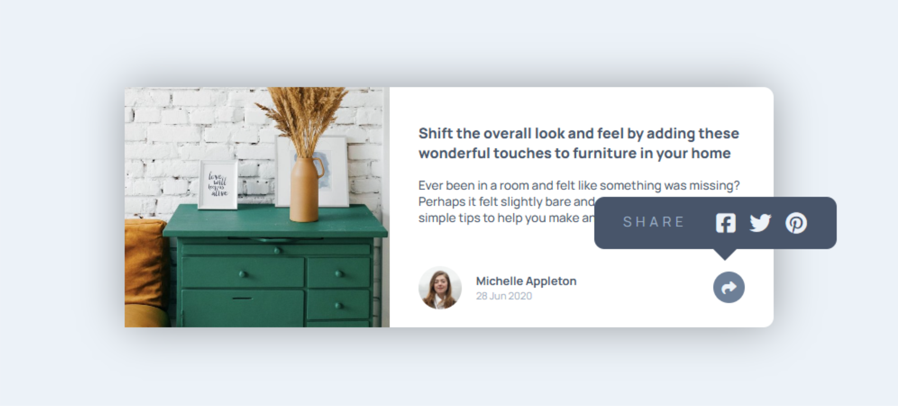

# Article Preview Component



Um componente de pré-visualização de artigo com design responsivo, inspirado em desafios do Frontend Mentor.  
O projeto conta com funcionalidade para exibir e ocultar um balão de compartilhamento de redes sociais, incluindo uma seta indicativa, com posicionamento preciso no layout desktop.

---

## 🚀 Tecnologias Utilizadas

- **HTML5**
- **CSS3**  
  - Flexbox  
  - CSS Grid  
  - Positioning (`absolute`, `relative`, `inset`, `top`, `left`)
  - Media Queries para responsividade
- **JavaScript (ES6+)** para manipulação do DOM

---

## 💡 Grande Desafio

O maior desafio do projeto foi manipular a `section` `.social-medias` para que aparecesse corretamente no layout desktop e mobile.  
Foi necessário ajustar propriedades como:

- `position: absolute`
- `top` e `left` para posicionamento preciso
- `inset` para ocupar a área no mobile
- `::after` para criar a seta indicativa abaixo do balão

---

## 📂 Estrutura de Arquivos
```
article-preview-component/
│
├── index.html
├── src/
│ ├── css/
│ │ ├── style.css # Estilos base (mobile-first)
│ │ └── media.css # Estilos para telas desktop
│ ├── images/ # Imagens e favicon
│ │ ├──avatar-michelle.jpg
│ │ ├── drawers.jpg
│ │ ├── favicon-32x32.png
│ │ └── preview.png
│ └── script/
│ │ └── script.js # Lógica para exibir/ocultar redes sociais
```

---

## 🌐 Como Acessar

### 🔹 Versão Online
Acesse o projeto no GitHub Pages pelo link:  
[charlesson-mp.github.io/article-preview-component](https://charlesson-mp.github.io/article-preview-component)

### 🔹 Clonando o Repositório
```bash
# Clonar o repositório
git clone https://github.com/charlesson-mp/article-preview-component.git

# Acessar a pasta do projeto
cd article-preview-component

# Abrir o arquivo index.html no navegador